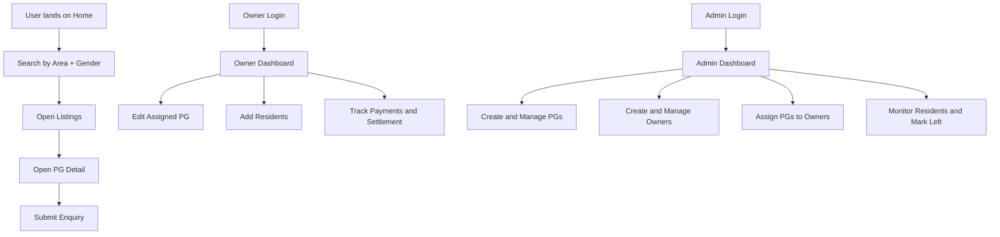
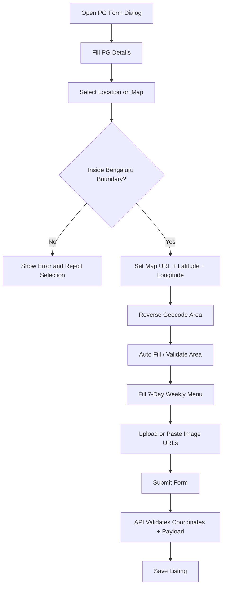
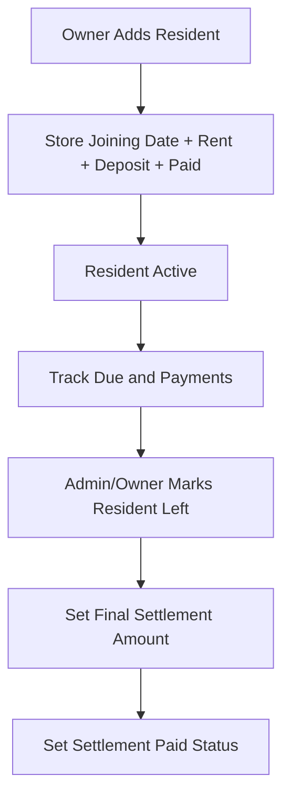
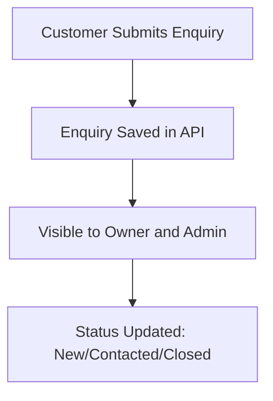
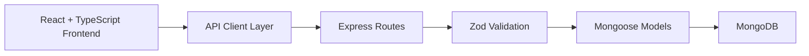

# NestPG Flow

This document explains the primary user and system flows for the NestPG platform.

## 1. High-Level Product Flow

## 2. PG Creation and Update Flow (Admin and Owner)

## 3. Resident Lifecycle Flow

## 4. Enquiry Flow

## 5. Validation Rules Summary

- Phone inputs: restricted to 10 digits in forms.
- Number fields: spinner arrows removed; typing is flexible.
- Map selection: restricted to Bengaluru bounds.
- Coordinates: validated in frontend and backend before save.
- Weekly menu: 7-day menu is required.
- Image URLs: sanitized and limited.

## 6. Technical Layers

## 7. Notes

- Home and Listings are customer-facing discovery pages.
- Owner can update assigned PG details and manage residents.
- Admin controls platform-level listing, owner, and resident operations.
